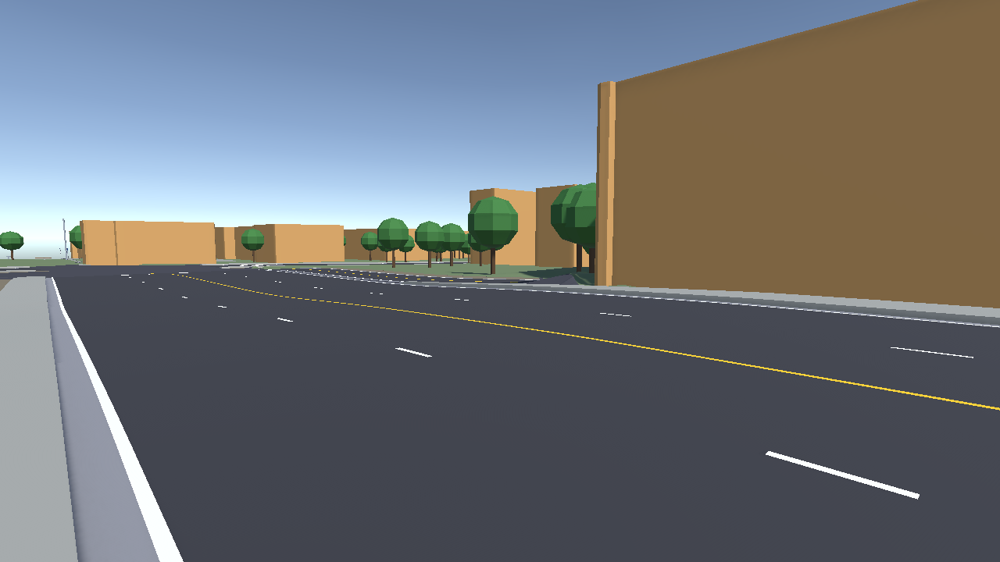

# Integrantes -
Guilherme Seabra Rodriguez RA:23.01729-5 

Vitor Holland Baptista RA:22.01089-0

# MauaVR — Passeio Virtual pelo Campus do IMT Mauá

Projeto de Realidade Virtual em Unity: com um óculos VR, o usuário caminha pelo modelo 3D do campus do Instituto Mauá de Tecnologia e encontra placas interativas que identificam cada bloco (Trocamos o tema!). 




---

## Requisitos

| Item | Versão / observação |
|---|---|
| Unity | **6000.6.8f1** (Unity 6.6) com Universal Render Pipeline (URP) |
| Pacotes | OpenXR 1.18.0, XR Plug-in Management 4.7.0, XR Core Utils 2.6.0, Input System 1.20.1 |
| Óculos | Meta Quest (2, 3 ou Pro) via **Quest Link** (cabo) ou **Air Link**. |
| Sem óculos | Para testes com mouse e teclado |

## Como abrir e executar

1. No Unity Hub: **Add → Add project from disk** e selecione esta pasta (na primeira abertura a Unity regenera a pasta `Library`, o que leva alguns minutos).
2. Abra a cena **`Assets/Scenes/CampusMaua.unity`**.
3. **Sem óculos:** aperte **Play** e use os controles da tabela abaixo.
4. **Com óculos:** abra o app **Meta Quest Link** no PC, defina-o como *runtime OpenXR ativo* (Configurações → Geral), conecte o Quest pelo Link e aperte **Play**.

## Controles

| Ação | Óculos (controles do Quest) | PC (teclado/mouse) |
|---|---|---|
| Andar | Analógico esquerdo (na direção do olhar) | W A S D / setas |
| Correr | Clicar o analógico esquerdo | Shift |
| Girar 45° | Analógico direito | Q / E |
| Olhar em volta | Movimento da cabeça | Segurar botão direito do mouse |
| Fixar painel da placa | Gatilho | F |
| Voltar ao ponto inicial | Botão B | R |

## Funcionalidades
- **Mapa 3D do campus** (~400 × 455 m, 447 mil triângulos) importado com a escala real em metros e colisão: o usuário anda sobre o terreno, as calçadas e as ruas0.
- **20 placas interativas**, uma em frente a cada bloco (A, C, D, F, G, H, I, J, L, M, N, P, Q, R, S, U, V, Ginásio, Centro de Vivência e Portaria 1):
  - ao se aproximar, a placa acende e abre um painel com a área e a altura do prédio;
  - cada placa tem um campo **Descrição** editável no Inspector.
- **Modo PC** para testar e apresentar sem o óculos.

## Estrutura do projeto

```
MauaVR/
├── Assets/
│   ├── Scenes/CampusMaua.unity    cena principal
│   ├── Scripts/
│   │   ├── LocomocaoVR.cs         locomoção VR + modo PC
│   │   └── PlacaBloco.cs          comportamento das placas interativas
│   ├── Editor/                    automação do projeto (menu "MauaVR" na Unity)
│   │   ├── MauaVRSetup.cs         configura OpenXR, cria materiais e monta a cena
│   │   ├── MauaVRPlacas.cs        posiciona as placas na frente de cada bloco
│   │   ├── MapaImportSettings.cs  configurações de importação do .obj
│   │   └── MauaVRCaptura.cs       gera imagens da cena (pasta Imagens/)
│   ├── Mapa/
│   │   ├── campus_maua.obj/.mtl   modelo 3D do campus (convertido para Y-up)
│   │   ├── blocos.json            posição e contorno de cada bloco
│   │   └── Materiais/             materiais gerados a partir do .mtl
│   ├── Settings/                  configurações do URP
│   ├── XR/                        configurações do OpenXR
│   └── TextMesh Pro/              fontes usadas nas placas
├── Ferramentas/                   scripts Python de preparação dos dados
├── Imagens/                       capturas da cena
├── Packages/  ProjectSettings/    configuração do projeto Unity
└── README.md
```

### Menu `MauaVR` (dentro da Unity)

| Item | O que faz |
|---|---|
| Configurar Tudo | Configura o OpenXR, cria os materiais e remonta a cena do zero |
| 1. Configurar OpenXR | Ativa o OpenXR para PC e os perfis dos controles Meta/Oculus |
| 2. Criar Materiais do Mapa | Cria um material URP para cada material do `.mtl` |
| 3. Criar Cena CampusMaua | Importa o mapa, adiciona as colisões, define o ponto inicial e cria o rig de VR |
| 4. Criar Placas dos Blocos | Recria as placas e **preserva as descrições** já escritas |

## Origem dos dados e preparação

O modelo 3D vem do projeto **MOVER** (simulador do campus no CARLA), gerado a partir do levantamento topográfico (DXF) do campus.

- **`Ferramentas/converter_obj.py`** — converte o `.obj` de Z-up para Y-up (padrão da Unity), centraliza o mapa na origem e transforma os objetos (`o`) em grupos (`g`), para que a Unity separe cada parte (terreno, pista, calçada, edificações…).
- **`Ferramentas/blocos.py`** — separa cada prédio da malha `edificacoes` (componentes conectados) e atribui a ele o nome do bloco a partir da posição das letras no mapa oficial do campus, usando o mesmo registro foto → coordenadas do pipeline MOVER.
- O posicionamento das placas é automático


